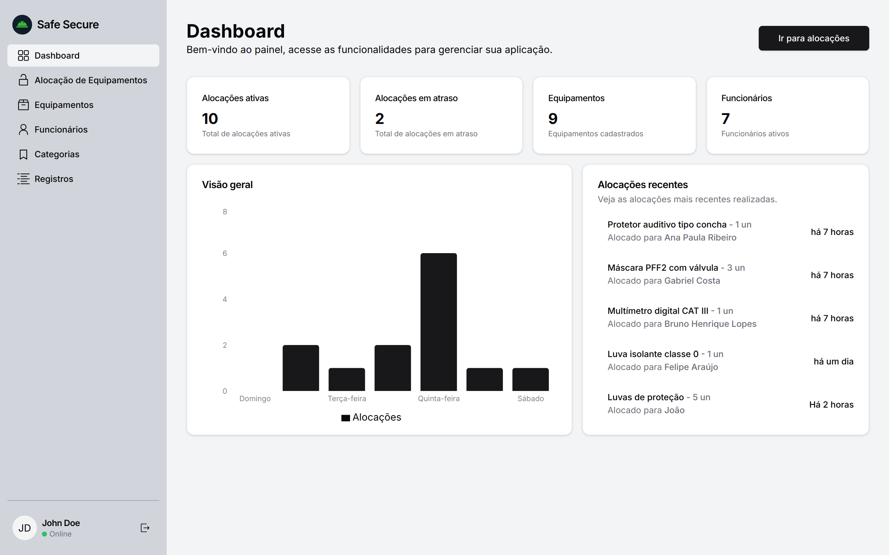
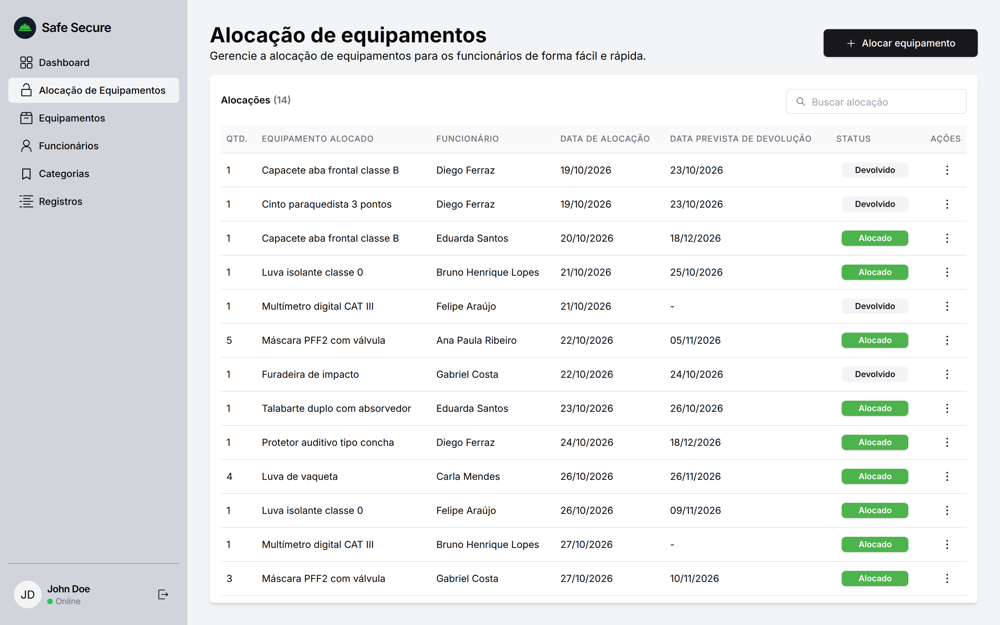
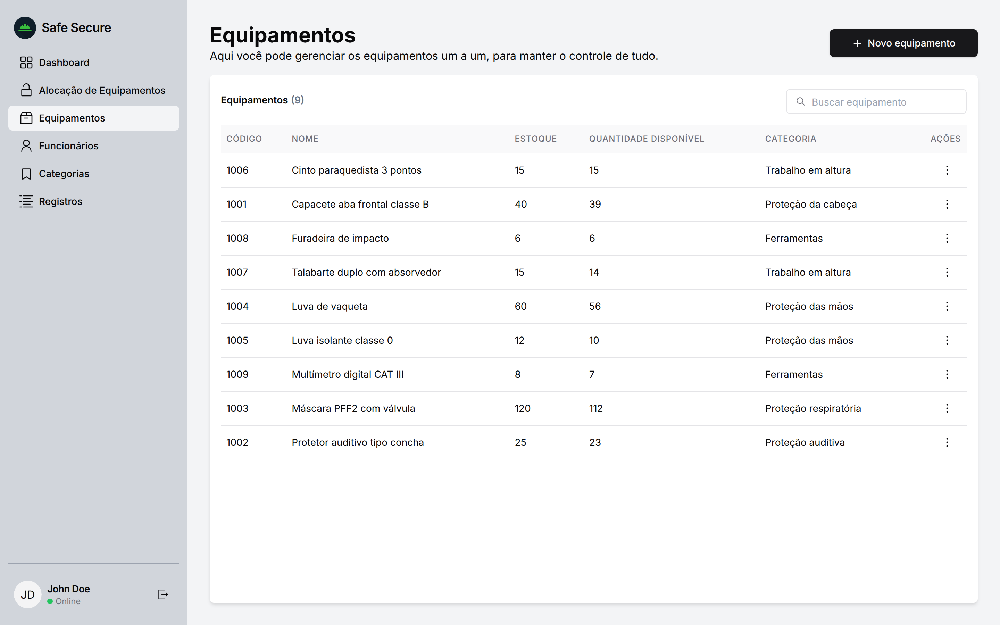
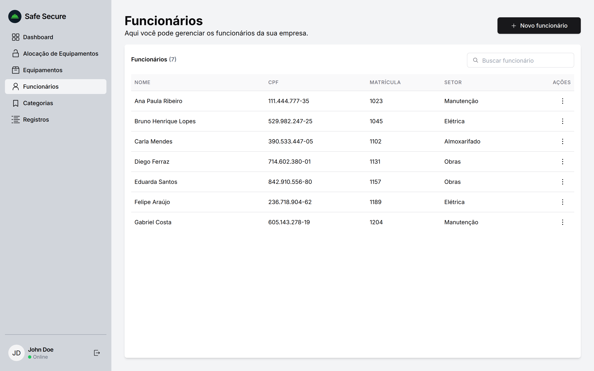
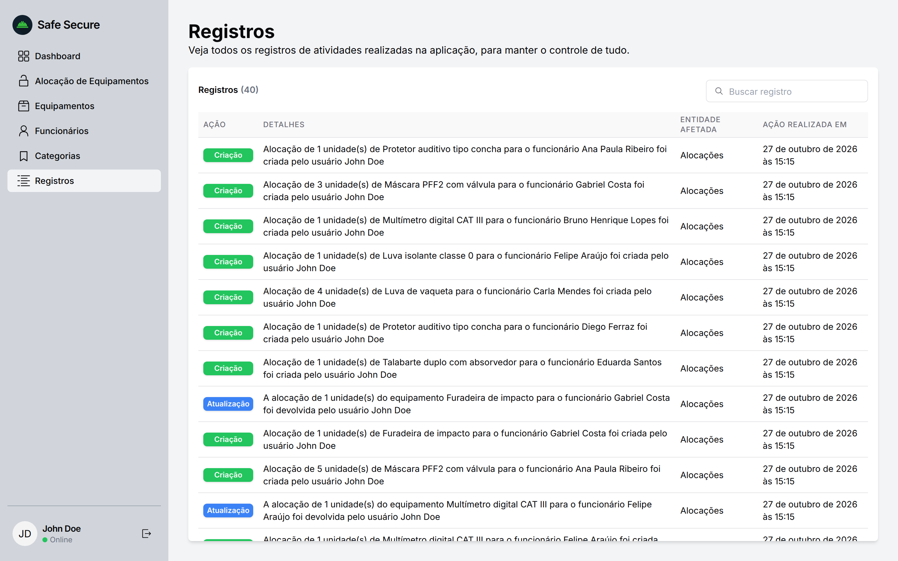
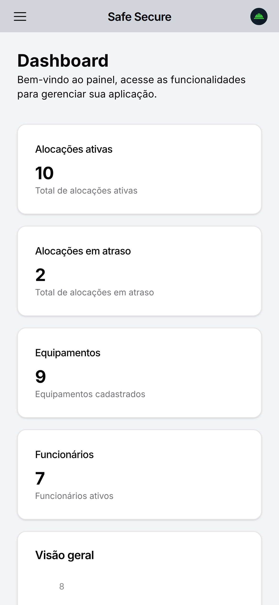
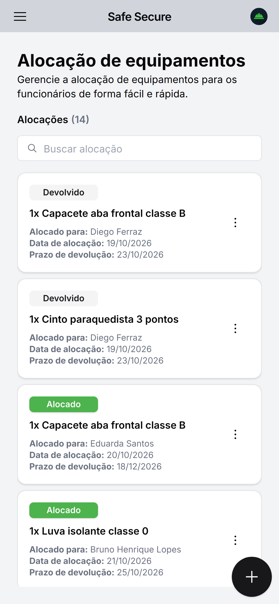
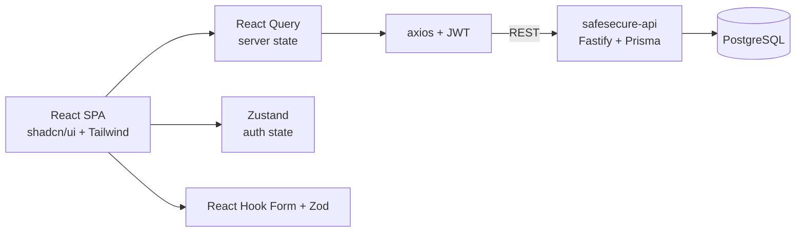

<div align="center">


# Safe Secure

**Web app to track safety equipment lent to employees: stock, allocations, returns and an audit log.**


[Features](#features) •
[Screenshots](#screenshots) •
[Architecture](#architecture) •
[Tech stack](#tech-stack) •
[Running locally](#running-locally) •
[History](#project-history)

</div>

> [!WARNING]
> **Discontinued.** Safe Secure is no longer maintained. This repository is archived and kept as a portfolio reference. The hosted version is offline.



## About

Safe Secure was built in one week in September 2024 for a university project on workplace safety. A company lends personal protective equipment (helmets, gloves, masks, harnesses) and tools to its employees, and needs to know what is out, with whom, until when, and who changed what.

The interface is in Brazilian Portuguese. It talks to [safesecure-api](https://github.com/RanielliMontagna/safesecure-api), a Fastify and PostgreSQL backend built alongside it.

## Features

- **Dashboard**: active and overdue allocations, equipment and employee counts, allocations per weekday and the latest allocations.
- **Allocations**: lend an item to an employee with a quantity and an optional due date, mark it as returned, and search the history.
- **Equipment**: code, category, total stock and available quantity, updated automatically as items go out and come back.
- **Employees**: name, CPF, registration number and sector.
- **Categories**: group equipment by type, such as head, hand or fall protection.
- **Audit log**: every create, update, delete and return is recorded with who did it and when.
- **Responsive**: data tables on desktop; cards, a drawer menu and a floating action button on mobile.
- **Auth**: email and password sign-in with a JWT.

## Screenshots

<table>
  <tr>
    <td width="50%"><p align="center"><sub>Allocations and returns</sub></p></td>
    <td width="50%"><p align="center"><sub>Equipment stock</sub></p></td>
  </tr>
  <tr>
    <td width="50%"><p align="center"><sub>Employees</sub></p></td>
    <td width="50%"><p align="center"><sub>Audit log</sub></p></td>
  </tr>
</table>

<p align="center">
  
  &nbsp;&nbsp;
  
</p>

<sub>Screenshots taken in October 2026 from a local run with fictional data. The "Luvas de proteção / João" entry in the dashboard is a placeholder hard-coded in the app.</sub>

## Architecture



```text
src/
├── api/            # axios clients and types per resource
├── containers/     # pages: dashboard, allocations, equipment, employees, categories, logs, login
│   └── <page>/     # table and mobile list views, dialogs and one hook per component
├── components/     # app bar, sidebar, inputs, date picker, empty state; ui/ holds the shadcn components
├── routes/         # public and private routes
└── constants/
```

## Tech stack

| Area | Tools |
| --- | --- |
| UI | React 18, TypeScript, Tailwind CSS, shadcn/ui (Radix UI), Lucide and Radix icons, Recharts |
| Data and state | React Query 3, Zustand, axios, TanStack Table |
| Forms | React Hook Form, Zod, zod-i18n-map, i18next |
| Build | Vite 5, ESLint, Prettier |
| Hosting | Vercel (no longer online) |

## Running locally

You need [safesecure-api](https://github.com/RanielliMontagna/safesecure-api) running first. Last checked in October 2026 on Node.js 24.

```bash
git clone https://github.com/RanielliMontagna/safesecure-front.git
cd safesecure-front
npx pnpm@9 install
cp .env.example .env.local    # VITE_API_URL=http://localhost:3333
npx pnpm@9 dev                # http://localhost:5173
```

Sign in with the user created by the API seed: `john@doe.com` / `safesecure`.

## Project history

- **September 11, 2024**: project setup, routing and the login screen.
- **September 12–16, 2024**: categories, employees, equipment, allocations and the audit log.
- **September 17–18, 2024**: search on every list, mobile layouts and the dashboard.
- **October 2026**: archived.

## Related

- [safesecure-api](https://github.com/RanielliMontagna/safesecure-api): the Fastify, Prisma and PostgreSQL backend.

## License

[MIT](LICENSE)
